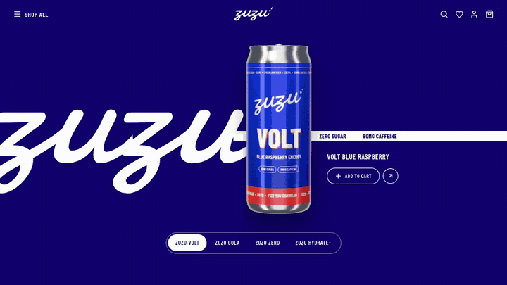

# zuzu: product parallax showcase

A full-screen product carousel with a layered parallax wipe. The background wipes in from the right, the old can drops away and the new can swings in, all on one Figma-matched easing curve. Built with **Next.js, React, TypeScript, Tailwind CSS v4 and Motion**.

`zuzu` is a fictional soda brand made for this demo. The code is MIT; take it, rebrand it, ship it.



<!-- TODO: live demo link once deployed -->

## Features

- **Exact motion from the Figma original:** Smart Animate, `cubic-bezier(0.6, 0.01, 0.11, 1)`, 1000 ms. Can and colour move together; the can clears the frame a beat before the colour lands
- **One file to rebrand:** colors, copy and product images live in [`data/products.ts`](data/products.ts)
- **GPU-friendly:** the wipe is two opposing `translateX` layers, not an animated `clip-path`
- **Responsive:** desktop layout matches the reference; a stacked layout takes over below 768 px (container query, so it adapts to its box, not the window)
- **Accessible:** WAI-ARIA tabs with arrow / Home / End keys, a pause button, `prefers-reduced-motion` turns the fly-through into a crossfade and stops autoplay
- **Polite autoplay:** pauses on nav hover, when the tab is hidden and when the showcase is off-screen
- **Swipe** on touch devices, **preloads** every product image
- **Bonus can studio:** a React Three Fiber scene that renders your own label onto a 3D can and exports transparent WebPs

## Quick start

```bash
pnpm install
pnpm dev
```

Open http://localhost:3000. The can studio lives at http://localhost:3000/studio.

## URL controls (filming & demos)

The demo page reads these from the address bar, e.g. `/?bpm=128&film=1`:

| Param | Does |
|---|---|
| `bpm=128` | Sync autoplay to a song: one product every 4 beats (`&beats=2` to change) |
| `interval=2000` | ms per product (default 1800, the reference pace) |
| `speed=0.25` | Slow motion for every animation |
| `debug=1` | Outlines the layers and the wipe edge: great for breakdown shots |
| `film=1` | Hides the pause button, the "Get the code" button and the cursor |
| `autoplay=0` | Manual only |
| `start=cola` | First product (by `id`) |

The same options exist as component props: `interval`, `speed`, `debug`, `hideControls`, `autoplay`, `initialIndex`.

## Use it in your project

Copy [`components/product-showcase/`](components/product-showcase) into any React 19 + Tailwind v4 project (Next.js, Vite, React Router…) and install Motion and Lucide:

```bash
pnpm add motion lucide-react
```

Then give it a sized parent:

```tsx
import { ProductShowcase } from "@/components/product-showcase";
import { products } from "@/data/products";

export default function Page() {
  return (
    <main className="h-dvh">
      <ProductShowcase products={products} interval={1800} />
    </main>
  );
}
```

The component uses a `font-condensed` utility. Add it to your CSS (any condensed sans works):

```css
@theme inline {
  --font-condensed: "Barlow Condensed", ui-sans-serif, system-ui, sans-serif;
}
```

### Props

| Prop | Type | Default | |
|---|---|---|---|
| `products` | `Product[]` | (required) | See [`types.ts`](components/product-showcase/types.ts) |
| `autoplay` | `boolean` | `true` | Off automatically for reduced-motion users |
| `interval` | `number` | `3000` | ms per product, transition included. The reference pace is `1800` |
| `initialIndex` | `number` | `0` | |
| `onAddToCart` | `(product) => void` | | "Add to cart" button |
| `onView` | `(product) => void` | | Round arrow button |
| `onChange` | `(product, index) => void` | | Fires on every change |

## Customize

**Rebrand:** edit [`data/products.ts`](data/products.ts). Each product has a `theme`:

| Key | Used for |
|---|---|
| `background` | Slide background; any CSS background, gradients included |
| `wordmark` | The giant logo |
| `stripe` / `stripeText` | The claims band |
| `foreground` | Header, product name, buttons, nav |
| `accent` | Text on white, e.g. the active nav pill |

**Tune the motion:** everything lives in [`motion.ts`](components/product-showcase/motion.ts): `EASE`, `DURATION`, `EXIT_MARGIN` (how far past the edge the old can lands, which sets how much it leads the colour), and `canVariants` (how far the can travels and tilts). The exit distance is measured from the live layout, so the timing holds on any screen size.

**Swap the logo:** [`wordmark.tsx`](components/product-showcase/wordmark.tsx) holds an SVG path. To make your own from any font:

```bash
pnpm wordmark path/to/font.woff yourbrand public/brand/wordmark.svg
```

Then paste the generated `d` into `WORDMARK_PATH` (and fix the viewBox).

## Make your own cans

1. Edit the label specs in [`app/studio/labels.ts`](app/studio/labels.ts) (colors, flavor, claims) or redraw `drawLabel` entirely. It's plain Canvas 2D.
2. `pnpm dev`, open `/studio` and drag to inspect.
3. `BASE_URL=http://localhost:3000 pnpm render:cans` writes transparent 960×2400 WebPs to `public/products/` (uses your installed Chrome via Playwright).

Already have product photos? Skip the studio: drop transparent PNG/WebP files in `public/products/` and point `image.src` at them. The studio is never loaded by the showcase, so Three.js stays out of your bundle.

## Email capture (optional)

The demo has a **Get the code** button that posts to `/api/subscribe`. Keys stay on the server.

1. `cp .env.example .env.local`
2. Set `EMAIL_PROVIDER` to `kit`, `beehiiv` or `webhook` and fill in that provider's keys.
3. Restart `pnpm dev`.

| Provider | What happens |
|---|---|
| `kit` | Creates the subscriber and adds them to `KIT_FORM_ID`. Deliver the link with the form's incentive email or an automation. |
| `beehiiv` | Creates a subscription with `send_welcome_email: true`. Put the link in your welcome email. |
| `webhook` | POSTs `{ email, source, subscribedAt }` to `EMAIL_WEBHOOK_URL` (Zapier, Make, your backend…) |

Without a provider the form politely says sign-ups aren't open yet. The route validates emails, has a honeypot field, and rate-limits per IP.

**Instagram DM automation:** point a ManyChat *External Request* at `POST https://your-site/api/subscribe` with JSON body `{"email": "<email field>", "source": "instagram"}`.

## Deploy

Push to GitHub, import the repo on [Vercel](https://vercel.com/new), add the env vars from `.env.example`, deploy. Everything except `/api/subscribe` is static.

## Project structure

```
components/product-showcase/   ← the part you copy
  ProductShowcase.tsx          state, autoplay, swipe, a11y
  Slide.tsx                    one product: background, logo, band, can, copy
  PillNav.tsx                  tabs with the gliding pill (shared layoutId)
  Header.tsx                   top bar
  motion.ts                    easing, duration, variants
  wordmark.tsx                 logo as an SVG path
  types.ts
data/products.ts               ← rebrand here
app/demo-showcase.tsx          URL controls for the demo
app/get-code.tsx               "Get the code" email dialog
app/api/subscribe/route.ts     email capture endpoint
lib/subscribe.ts               Kit / beehiiv / webhook providers
app/studio/                    bonus 3D can studio (React Three Fiber)
scripts/                       render-cans.mjs, wordmark.mjs
```

## Credits

- Layout and motion inspired by [@abhidesigns__](https://www.instagram.com/abhidesigns__/)'s Figma concept. This repo uses a fictional brand and original assets; the original brand and its artwork belong to their owners.
- Built by [@rahuldecode](https://www.instagram.com/rahuldecode/).
- Fonts: Damion (wordmark, converted to outlines) and Barlow / Barlow Condensed, all SIL Open Font License. Icons: Lucide (ISC).

## License

MIT. The `zuzu` brand is fictional, and its logo and can renders are free to reuse too.
